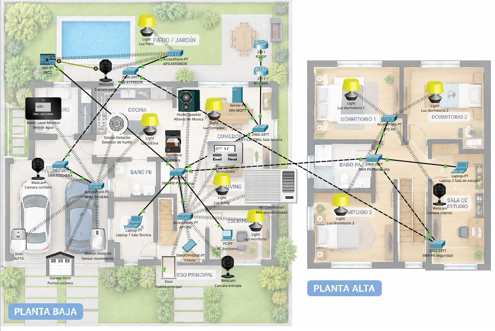
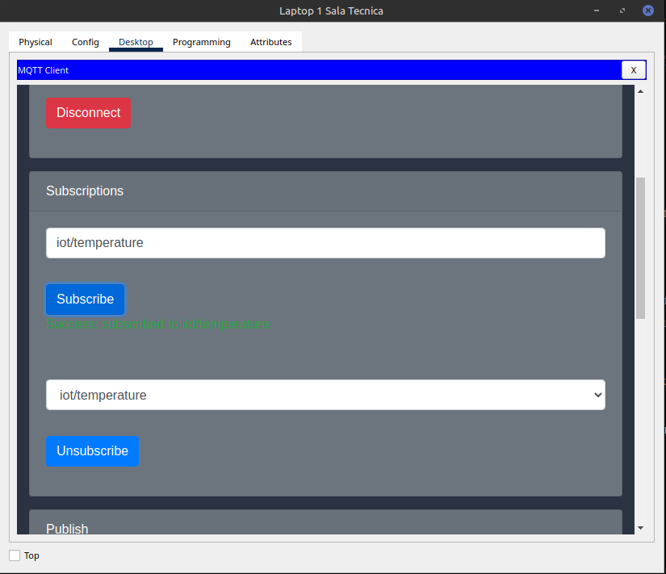
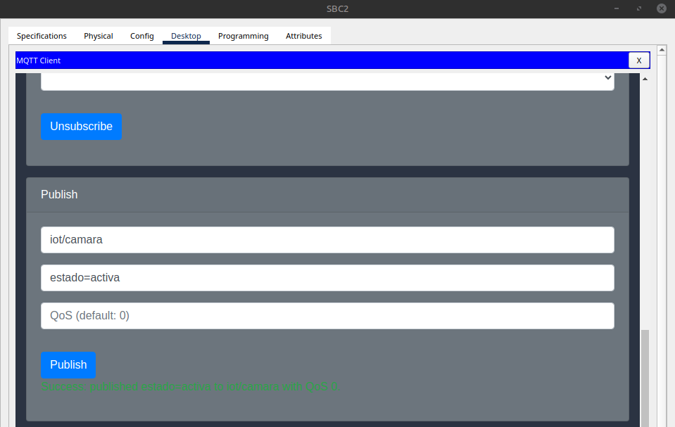
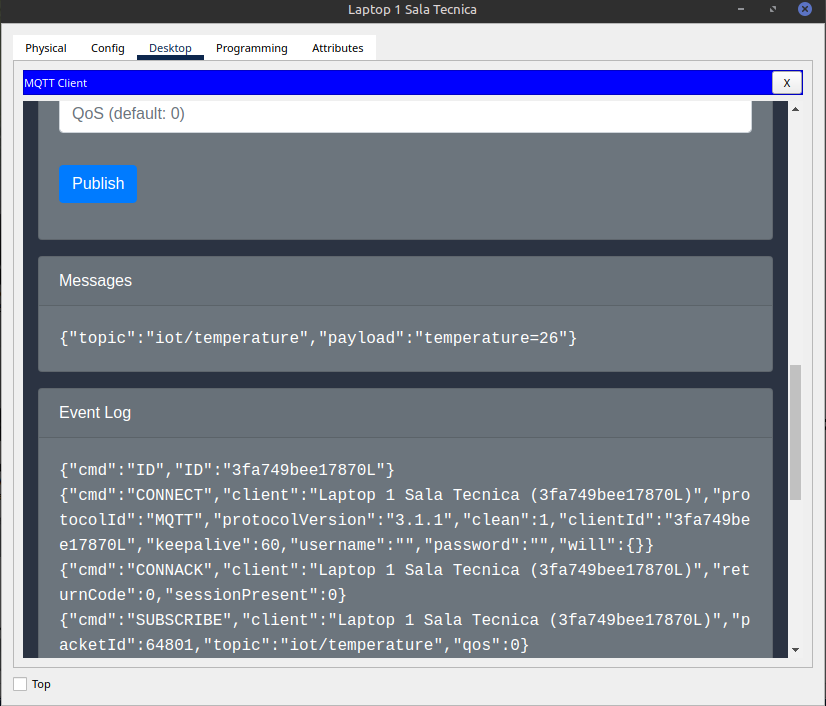
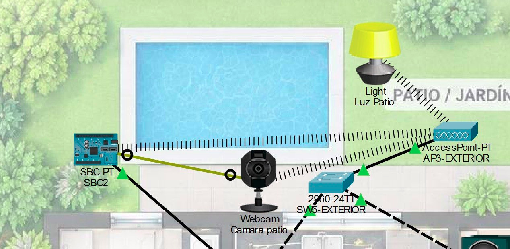

# IoT sobre MQTT: despliegue de red inteligente en Cisco Packet Tracer

> 🇬🇧 [English version](README.md)

Red simulada con múltiples VLAN que transporta datos IoT mediante **MQTT**. Un dispositivo IoT (cámara) está conectado a una **SBC** (placa de desarrollo) que publica en un **broker MQTT**; una laptop suscripta al mismo topic recibe los datos.



## Escenario

Casa inteligente de dos plantas (planta baja y planta alta, más patio/jardín y cochera). R1 (`R1-CASA`) es el router de la casa y R2 (`R2-ISP`) cumple el rol del proveedor de internet. La casa tiene luces, cámaras web, detector de humo, monitor de nivel de agua, termostato, sirena, sensor de movimiento y otros dispositivos IoT, conectados mediante switches y puntos de acceso inalámbricos. El broker MQTT corre en `SRV-MQTT`.

## Flujo de datos

```
Cámara ──(puerto IoT D0)──> SBC ──(publica MQTT)──> Broker MQTT (VLAN 40) ──> Laptop1 (suscriptora)
```

La cámara no tiene un cliente MQTT propio, por lo que la SBC actúa como intermediaria: se conecta a la red y publica en su nombre.

## Requisitos cubiertos

| Requisito | Mínimo | Estado |
|---|---|---|
| Switches (con ≥3 VLAN troncalizadas) | 6 | ✅ |
| Access Points inalámbricos | 4 | ✅ |
| Routers | 2 | ✅ |
| Hosts / clientes / dispositivos IoT | 20 | ✅ |
| Servidor broker MQTT | 1 | ✅ |
| DHCP | – | ✅ |

## Qué se implementó

- Segmentación por VLAN troncalizadas entre switches
- DHCP en R1 para las VLAN 10, 20 y 30 (la VLAN 40 usa direccionamiento estático)
- Ruteo inter-VLAN con router-on-a-stick (subinterfaces 802.1Q) en R1
- Ruteo estático entre R1 y R2 por `10.0.0.0/30`
- Acceso inalámbrico con 4 APs
- Broker MQTT en un Server-PT (`192.168.40.10:1883`, VLAN 40, gateway `192.168.40.1`) usando el script *MQTT Broker (Python)* incluido en Packet Tracer, sin modificar y sin autenticación
- Publicador (SBC) y suscriptor (Laptop1) en el topic `iot/temperature`

Detalle: [VLAN y direccionamiento](docs/es/addressing.md) · [MQTT](docs/es/mqtt.md) · [Problemas y soluciones](docs/es/troubleshooting.md)

## Cómo ejecutarlo

1. Abrir `topology/Proyecto.pkt` en Cisco Packet Tracer.
2. Abrir **Laptop1** y suscribirse al topic.
3. En la **SBC**, publicar en el broker (cliente MQTT o script Python).
4. Verificar que Laptop1 recibe los mensajes. También se puede usar el modo Simulación para ver los paquetes.

## Verificación

| Prueba | Resultado esperado |
|---|---|
| SBC → `ping 192.168.40.1` | Responde |
| SBC → `ping 192.168.40.10` | Responde |
| La SBC publica en el topic | Laptop1 recibe el mensaje |

### Evidencias

| Paso | Captura |
|---|---|
| Laptop1 (Sala Técnica) se suscribe a `iot/temperature` |  |
| SBC2 publica `temperature=26` con el cliente MQTT |  |
| Consola Python: conectada al broker `192.168.40.10`, suscripta a `iot/temperature` |  |
| Laptop1 recibe `temperature=26` en `iot/temperature` (Messages y Event Log) |  |
| Cámara del patio conectada a SBC2; AP3-EXTERIOR y SW5-EXTERIOR |  |

## Estructura del repositorio

```
├── topology/    Archivo de Packet Tracer e imagen de la topología
├── docs/        Direccionamiento, MQTT, problemas (docs/es/ = español)
├── configs/     R1.txt, R2.txt (running-configs)
└── evidence/    Capturas de las pruebas
```

## Tecnologías

Cisco Packet Tracer · VLAN / troncales 802.1Q · router-on-a-stick · ruteo estático · DHCP · Wi-Fi · MQTT · Python (SBC)

## Autores

Martín Daniels
