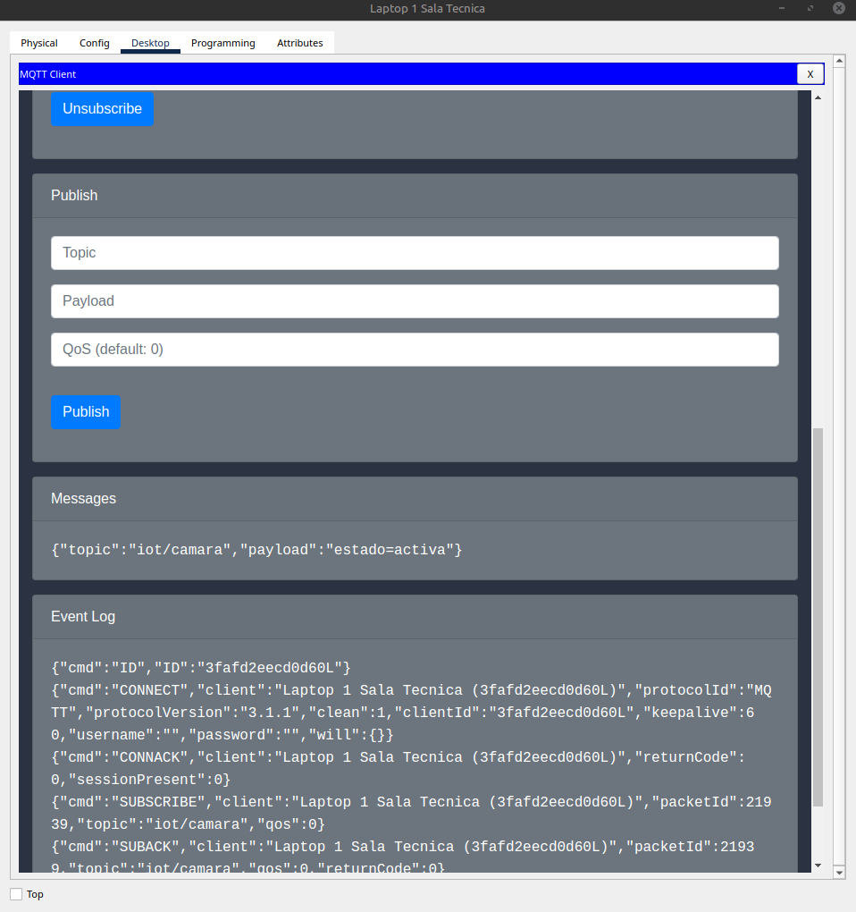
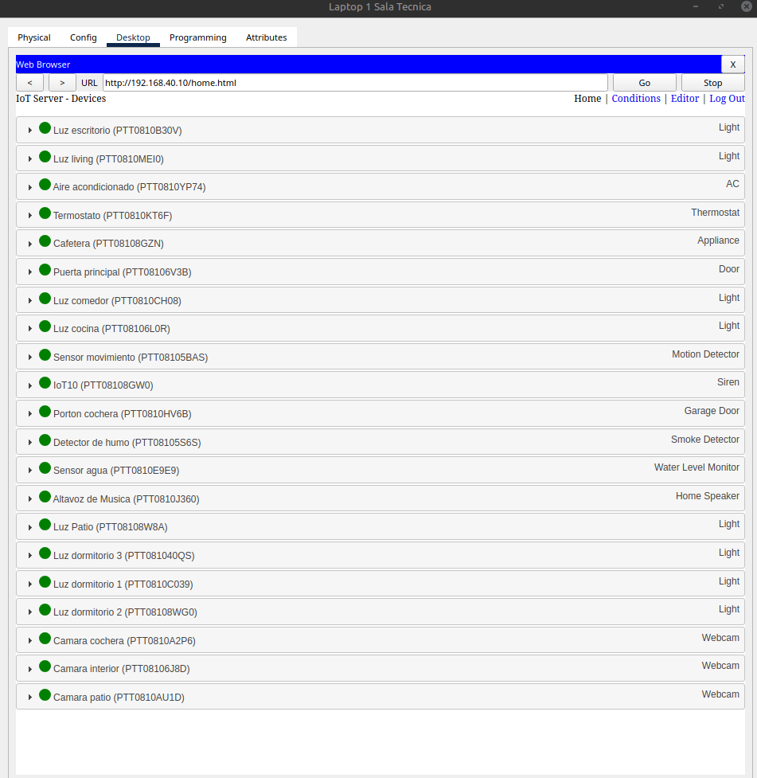

# IoT over MQTT: Smart Network Deployment in Cisco Packet Tracer

## Authors

**Group 11** · Instituto Superior Politécnico Córdoba (ISPC)
Tecnicatura Superior en Ciencia de Datos e Inteligencia Artificial · *Redes e IoT* · Comisión B.2 · 2026
Instructor: Violi, Dante

| | Name |
|---|---|
| 👤 | **Emiliano Sferco** |
| 👤 | **Artem Sukhovetskii** |
| 👤 | **Ivanna Tocci** |

> 🇦🇷 [Versión en castellano](README.es.md)

A simulated multi-VLAN network that carries IoT data over **MQTT**. An IoT device (camera) is attached to an **SBC** (single-board computer) that publishes to an **MQTT broker**; a laptop subscribed to the same topic receives the data.


https://github.com/user-attachments/assets/d0e55f66-36d0-40eb-b8ba-0465c00df849

## Scenario

A two-storey smart home (ground floor and upper floor, plus patio/garden and garage). R1 (`R1-CASA`) is the home router and R2 (`R2-ISP`) plays the ISP. The house has lights, webcams, a smoke detector, a water-level monitor, a thermostat, a siren, a motion detector and other IoT devices, connected through wired switches and wireless access points. The MQTT broker runs on `SRV-MQTT`.

## Data flow

```
Camera ──(IoT port D0)──> SBC2 ──(Wi-Fi, AP3-EXTERIOR)──> R1 ──> MQTT Broker (VLAN 40) ──> Laptop1 (subscriber)
```

The camera has no MQTT client of its own, so the SBC acts as the gateway: it joins the network over Wi-Fi and publishes on the camera's behalf.

## Requirements covered

| Requirement | Minimum | Status |
|---|---|---|
| Switches (with ≥3 trunked VLANs) | 6 | ✅ |
| Wireless Access Points | 4 | ✅ |
| Routers | 2 | ✅ |
| Hosts / clients / IoT devices | 20 | ✅ |
| MQTT broker server | 1 | ✅ |
| DHCP | – | ✅ |

## What is implemented

- VLAN segmentation trunked across switches
- DHCP on R1 for VLANs 10, 20 and 30 (VLAN 40 is addressed statically)
- Inter-VLAN routing with router-on-a-stick (802.1Q subinterfaces) on R1
- Static routing between R1 and R2 over `10.0.0.0/30`
- Wireless access via 4 APs
- MQTT broker on a Server-PT (`192.168.40.10:1883`, VLAN 40, gateway `192.168.40.1`) using Packet Tracer's built-in *MQTT Broker (Python)* script, unmodified, no authentication
- Publisher (SBC2) and subscriber (Laptop1) on topic `iot/camara`, message `estado=activa`
- IoT devices registered on the IoT Server running on the same Server-PT (`http://192.168.40.10/home.html`)

Full tables: [VLANs and addressing](docs/addressing.md) · [MQTT topics](docs/mqtt.md) · [Notes](docs/troubleshooting.md)

## How to run

1. Open `topology/Proyecto.pkt` in Cisco Packet Tracer.
2. Open **Laptop1** and subscribe to the topic.
3. On **SBC2**, open the MQTT client and publish `estado=activa` to `iot/camara`.
4. Check that Laptop1 receives the messages. You can also use Simulation mode to watch the packets.

## Verification

| Test | Expected result |
|---|---|
| SBC → `ping 192.168.40.1` | Replies |
| SBC → `ping 192.168.40.10` | Replies |
| SBC publishes to the topic | Laptop1 receives the message |

Evidence (screenshots) lives in [`evidence/`](evidence/).

### Evidence

| Step | Screenshot |
|---|---|
| Laptop1 (Sala Técnica) subscribes to `iot/camara` |  |
| SBC2 publishes `estado=activa` to `iot/camara` through the MQTT client |  |
| Laptop1 receives `estado=activa` on `iot/camara` (Messages and Event Log) |  |
| IoT devices registered on the IoT Server (including the patio camera) |  |

## Repository structure

```
├── topology/    Packet Tracer file and topology image
├── docs/        Addressing, MQTT, notes (docs/es/ = Spanish)
├── configs/     R1.txt, R2.txt (running-configs)
└── evidence/    Screenshots of tests
```

## Tech

Cisco Packet Tracer · VLAN / 802.1Q trunking · router-on-a-stick · static routing · DHCP · Wi-Fi · MQTT · Python (SBC)
